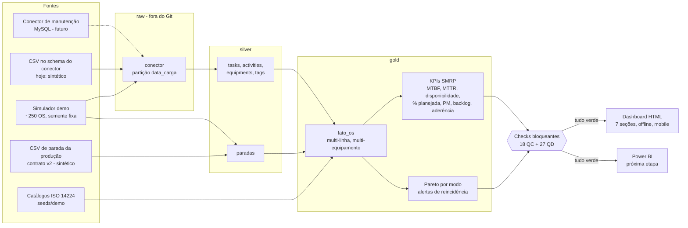
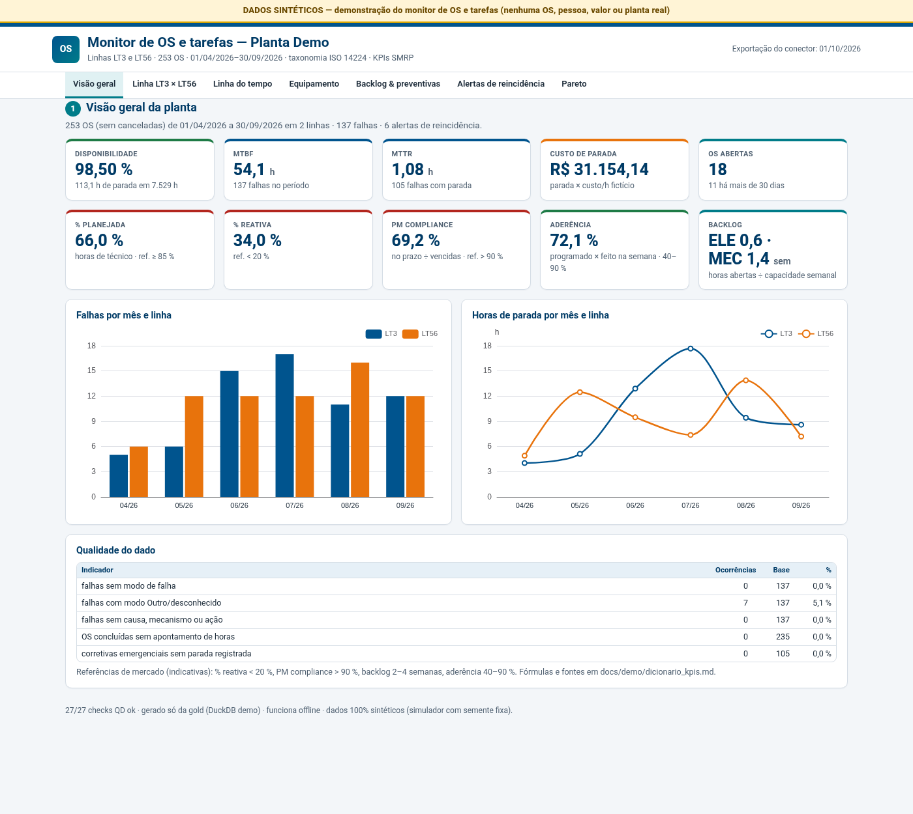
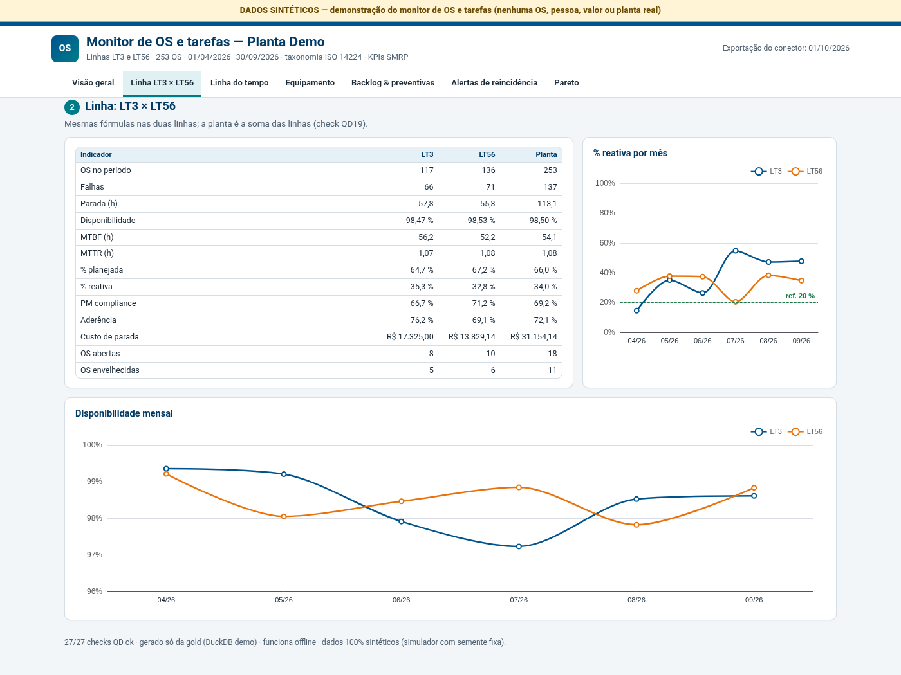
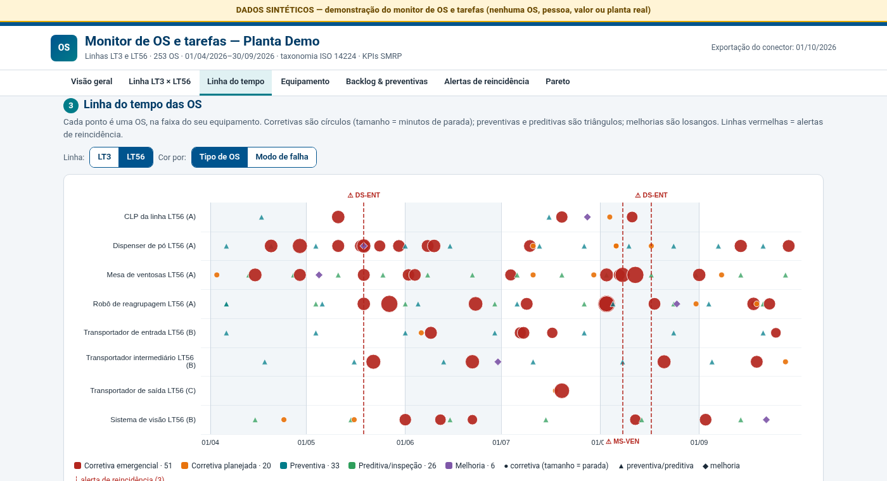
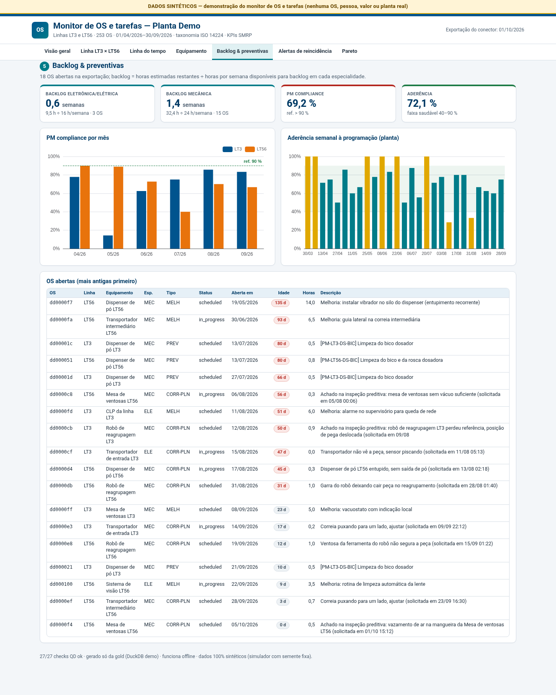
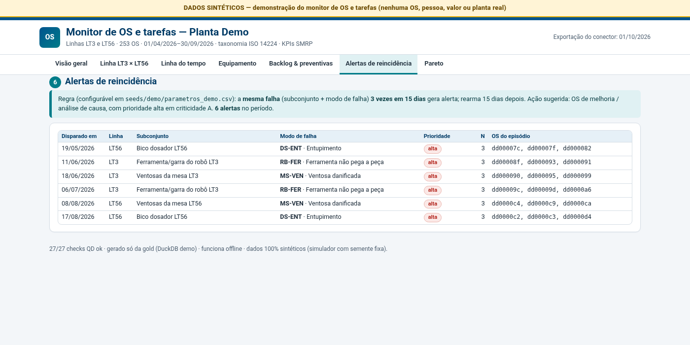

# IGMI — Inteligência de Gestão da Manutenção Industrial

Plataforma de **inteligência de gestão da manutenção industrial**, multi-linha e multi-equipamento: **dados de manutenção → DuckDB → dashboards e análises**.
Objetivo: enxergar os problemas de cada linha (quebras, paradas, MTTR, OS pendentes) e apoiar a montagem de planos de manutenção.

**Estado:** `fato_os` sobre CSV **sintético** no schema do Data Connector · parada da produção no contrato **v2 proposto**, com ingestão **simulada** sobre amostras sintéticas · **18 checks bloqueantes** no principal e **27** no dataset demo · CI em Ubuntu e Windows.

> **Todos os dados deste repositório são sintéticos** (ids `SINT-…`, OS `ffff…`, centro de custo `SINT-CC-A`, taxa fictícia). Nenhum dado real de planta é versionado.
> **Power BI é a próxima etapa.** Por ora existe só uma prévia estática gerada da gold (`python run.py preview`).

## Arquitetura



Dois pipelines usam a **mesma ingestão** e o **mesmo contrato do conector**:
- **principal** (`python run.py all`): base mínima sintética + parada v2 (contratos, QC01–QCV07);
- **demo** (`python run.py demo`): dataset realista de ~6 meses para as linhas **LT3** e **LT56**, com catálogos ISO 14224, KPIs SMRP, Pareto, reincidência e dashboard. Warehouse separado (`warehouse/demo.duckdb`).

## Dataset de demonstração

Tudo é **sintético** (simulador determinístico em `pmb/simulador.py`, semente fixa em `seeds/demo/parametros_demo.csv`):
- **Planta Demo** com 2 linhas (LT3, LT56). Cada linha tem robô de reagrupagem, transportadores, dispenser de pó, sistema de visão, CLP e mesa de ventosas, em hierarquia **linha > equipamento > subconjunto**, com criticidade **A/B/C** e especialidade (mecânica, eletrônica/elétrica).
- **~250 OS** (abr–set/2026): corretiva emergencial, corretiva planejada, preventiva, preditiva/inspeção e melhoria; abertas, em andamento, concluídas e canceladas; preventivas no prazo, atrasadas e vencidas; reincidências de propósito.
- Técnicos aparecem só como **função** ("Técnico Mec 1", "Técnico Elet 2"), nunca por nome.
- Classificação **ISO 14224** (modo/causa/mecanismo/ação) em tags; modos filtrados pela classe do equipamento.

Dashboard (`python run.py demo-preview` → `export/demo_dashboard.html`, um HTML offline com navegação fixa por seções, cards de KPI e layout de cartões no celular abaixo de 720 px):

| Visão geral | Linha LT3 × LT56 |
|---|---|
|  |  |
| **Linha do tempo das OS (LT3)** | **Linha do tempo das OS (LT56)** |
|  |  |
| **Equipamento** | **Backlog & preventivas** |
|  |  |
| **Alertas de reincidência** | **Pareto por modo** |
|  |  |

Prints de todas as seções em 1400 px e 390 px: `python tools/capturar_prints_demo.py <pasta>` (Chrome headless; `#so-<seção>` abre uma seção só).

Documentação: [dicionário de KPIs (fórmulas e fontes)](docs/demo/dicionario_kpis.md) · [modelo de dados](docs/demo/modelo_dados.md) · [glossário](docs/demo/glossario.md) · [seeds](seeds/demo/LEIAME.md).

## Como rodar

```bash
python -m pip install -r requirements.txt   # Python 3.11+
python run.py all       # seeds + ingestão (CSV sintético) + silver + gold + checks; sai != 0 se algum QC falhar
python run.py parada    # resumo da parada v2 (sintética): cargas, filas e alertas
python run.py preview   # gera export/dashboard_preview.html a partir só da gold
python run.py simular demo demo-preview   # dataset demo -> KPIs + 27 checks QD -> export/demo_dashboard.html
python run.py test      # pytest
```

## Estrutura

| Pasta | Conteúdo |
|---|---|
| `contrato/` | contrato do conector (`conector_v0.json`) e do CSV de parada (v0 vigente, v2 proposta) |
| `dados_sinteticos/` | entradas sintéticas (conector e parada) usadas pelo pipeline e pela CI |
| `seeds/` | parâmetros (tag de quebra), custo/h por centro de custo (fictício), colunas permitidas na gold |
| `sql/silver`, `sql/gold` | transformações; `fato_os`, `kpi_mttr_tecnico`, parada diária, filas, alertas, views da prévia |
| `pmb/` | ingestão, parada v2, checks (`quality.py`, `demo_quality.py`), simulador, pipeline e dashboard demo |
| `seeds/demo/` | cadastros e catálogos sintéticos da demo (linhas, equipamentos, ISO 14224, planos, parâmetros) |
| `dados_sinteticos/demo/` | saída do simulador: conector (tasks, activities, equipments, tags) + paradas |
| `sql/demo/` | gold da demo: fato_os_demo, KPIs, PM, backlog, aderência, Pareto, reincidência, qualidade do dado |
| `tests/` | testes de contrato, ingestão, injeção de falhas, simulador, KPIs e dashboards |
| `docs/` | contratos de parada e pedido de export à produção |

## Regras principais

- Custo só sobre hora de parada real (origem `csv_producao`) de OS concluída, com taxa do centro de custo lida do seed; tempo do técnico nunca vira custo.
- MTTR do técnico: numerador e denominador do mesmo conjunto (OS de quebra `$corrective` concluídas).
- Medidas diferentes nunca são somadas numa mesma coluna (lista de colunas permitidas da gold).
- Arquivo de parada com erro é rejeitado inteiro; exclusões nunca são apagadas sozinhas (fila de candidatos).

## Segurança

Sem credenciais no repositório. `fontes/`, `export/`, `raw/`, `.env*` e o warehouse ficam fora do Git (`.gitignore`).

## Roadmap

| Fase | O quê | Estado |
|---|---|---|
| 0 | Glossário (EN 13306), tipos de OS, matriz de criticidade A/B/C | feito na demo (seeds) |
| 1 | Base + primeiro painel: OS abertas, backlog, MTTR, Pareto | feito na demo (HTML) |
| 2 | Catálogos ISO 14224 por classe; painel de qualidade do dado; reunião semanal com backlog e aderência | feito na demo; validar catálogos com a equipe |
| 3 | Ler o conector real (MySQL) e o export real de paradas; Power BI sobre a gold | próximo |
| 4 | Estados e alarmes do CLP/robô (OPC UA) para OEE e microparadas | futuro |
| 5 | Reincidência por similaridade de texto; sugestão de modo/causa a partir do texto da OS (o técnico confirma); ajuste dos planos com MTBF real | futuro |

## IGMI: primeira camada de inteligência analítica

A camada `igmi/` é independente do pipeline anterior. O projeto público chama-se
**IGMI — Inteligência de Gestão da Manutenção Industrial**. O pacote técnico legado
`pmb/` foi mantido para compatibilidade; a eventual migração de nomes internos
será tratada de forma separada e testada.

Primeira entrega: **Analista de Confiabilidade determinístico** em modo somente
leitura, sobre a GOLD sintética, bloqueado pelos 27 checks QD existentes.
Ainda **não** há chamada a modelo de linguagem ou interface conversacional.

```powershell
py -m pip install -r requirements.txt
py run.py simular demo demo-preview
py run.py igmi --linha LT3 --formato markdown --saida export/igmi_relatorio_LT3.md
py run.py igmi --linha LT56 --formato json --saida export/igmi_LT56.json
py run.py test
```

O relatório cobre o período sintético fechado de **01/04 a 30/09/2026**, não os
últimos seis meses a partir de hoje. Consulte
[Entrega e próximos passos](docs/igmi/PROXIMOS_PASSOS.md) e
[Prompt Mestre](docs/igmi/PROMPT_MESTRE.md).

## IGMI 0.2.0 — Analista de Confiabilidade com IA (opcional)

A 0.2.0 adiciona uma CLI de inteligência artificial sem alterar os relatórios determinísticos.
Os dados passam pelas mesmas verificações de qualidade (27 QD) e as consultas seguem
**somente leitura**. É necessária uma chave pessoal e autorização explícita por comando;
**nenhuma chamada real à API é feita durante os testes.**

```bash
python -m pip install -r requirements-ai.txt
python run.py simular demo demo-preview
python run.py test

# Configure OPENAI_API_KEY e IGMI_OPENAI_MODEL em variáveis de ambiente (não no Git).
python run.py igmi-ia --linha LT3 \
  --pergunta 'Analise a LT3 de abril a setembro de 2026.' \
  --modelo "$IGMI_OPENAI_MODEL" --autorizar-api \
  --saida export/igmi_ia_LT3.md
```

Consulte [o guia de instalação, segurança e execução no Git Bash](docs/IGMI_0.2.0.md).
Para continuar **sem API**, use o comando anterior `python run.py igmi ...`.
