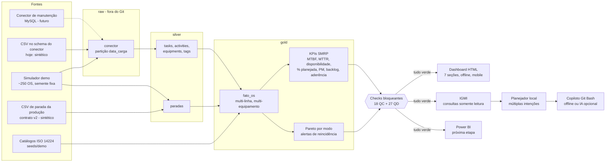
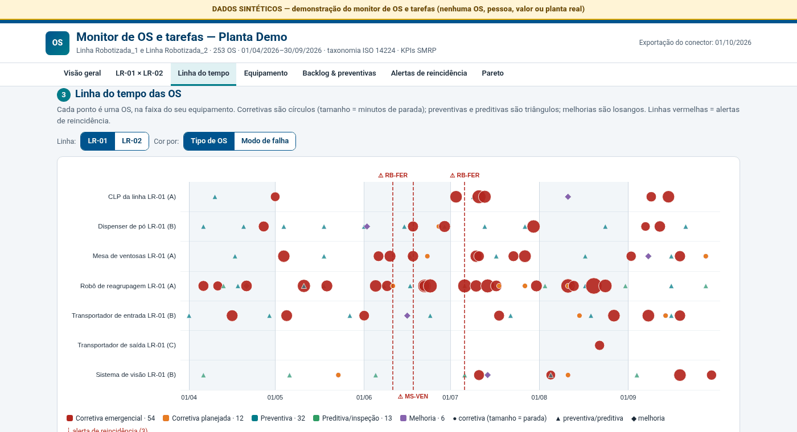
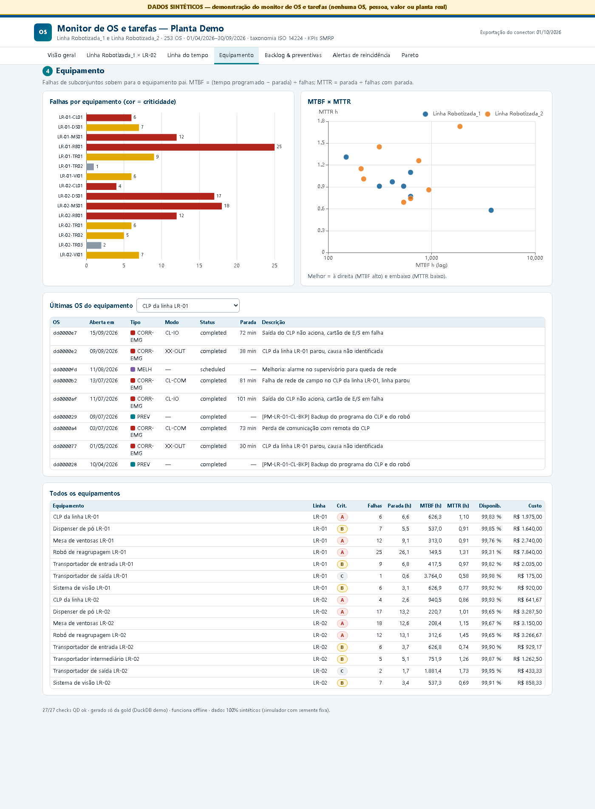
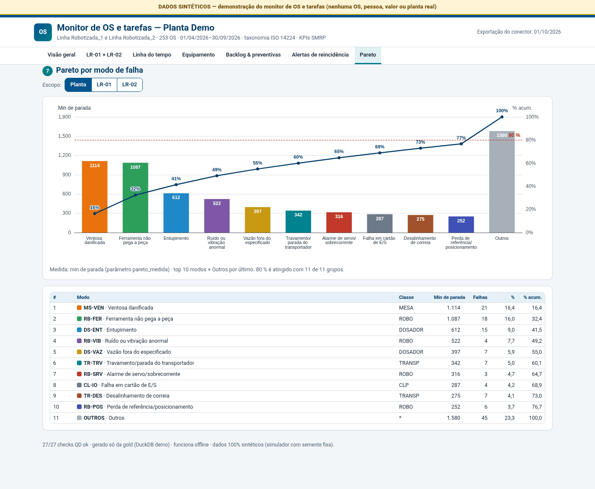

# IGMI — Inteligência de Gestão da Manutenção Industrial

Plataforma de **inteligência de gestão da manutenção industrial**, multi-linha e multi-equipamento: **dados de manutenção → DuckDB → dashboards e análises**.
Objetivo: enxergar os problemas de cada linha (quebras, paradas, MTTR, OS pendentes) e apoiar a montagem de planos de manutenção.

**Estado:** `fato_os` sobre CSV **sintético** no schema do Data Connector · parada da produção no contrato **v2 proposto**, com ingestão **simulada** sobre amostras sintéticas · **18 checks bloqueantes** no principal e **27** no dataset demo · CI em Ubuntu e Windows.

> **Todos os dados deste repositório são sintéticos** (ids `SINT-…`, OS `ffff…`, centro de custo `SINT-CC-A`, taxa fictícia). Nenhum dado real de planta é versionado.
> **Power BI é a próxima etapa.** Por ora existe só uma prévia estática gerada da gold (`python run.py preview`).

## Arquitetura



Dois pipelines usam a **mesma ingestão** e o **mesmo contrato do conector**:
- **principal** (`python run.py all`): base mínima sintética + parada v2 (contratos, QC01–QCV07);
- **demo** (`python run.py demo`): dataset realista de ~6 meses para as linhas **LT3** e **LT56**, com catálogos ISO 14224, KPIs SMRP, Pareto, reincidência e dashboard. Warehouse separado (`warehouse/demo.duckdb`).

## Dataset de demonstração

Tudo é **sintético** (simulador determinístico em `pmb/simulador.py`, semente fixa em `seeds/demo/parametros_demo.csv`):
- **Planta Demo** com 2 linhas (LT3, LT56). Cada linha tem robô de reagrupagem, transportadores, dispenser de pó, sistema de visão, CLP e mesa de ventosas, em hierarquia **linha > equipamento > subconjunto**, com criticidade **A/B/C** e especialidade (mecânica, eletrônica/elétrica).
- **~250 OS** (abr–set/2026): corretiva emergencial, corretiva planejada, preventiva, preditiva/inspeção e melhoria; abertas, em andamento, concluídas e canceladas; preventivas no prazo, atrasadas e vencidas; reincidências de propósito.
- Técnicos aparecem só como **função** ("Técnico Mec 1", "Técnico Elet 2"), nunca por nome.
- Classificação **ISO 14224** (modo/causa/mecanismo/ação) em tags; modos filtrados pela classe do equipamento.

Dashboard (`python run.py demo-preview` → `export/demo_dashboard.html`, um HTML offline com navegação fixa por seções, cards de KPI e layout de cartões no celular abaixo de 720 px):

| Visão geral | Linha LT3 × LT56 |
|---|---|
|  |  |
| **Linha do tempo das OS (LT3)** | **Linha do tempo das OS (LT56)** |
|  |  |
| **Equipamento** | **Backlog & preventivas** |
|  |  |
| **Alertas de reincidência** | **Pareto por modo** |
|  |  |

Prints de todas as seções em 1400 px e 390 px: `python tools/capturar_prints_demo.py <pasta>` (Chrome headless; `#so-<seção>` abre uma seção só).

Documentação: [dicionário de KPIs (fórmulas e fontes)](docs/demo/dicionario_kpis.md) · [modelo de dados](docs/demo/modelo_dados.md) · [glossário](docs/demo/glossario.md) · [seeds](seeds/demo/LEIAME.md).

## Como rodar

```bash
python -m pip install -r requirements.txt   # Python 3.11+
python run.py all       # seeds + ingestão (CSV sintético) + silver + gold + checks; sai != 0 se algum QC falhar
python run.py parada    # resumo da parada v2 (sintética): cargas, filas e alertas
python run.py preview   # gera export/dashboard_preview.html a partir só da gold
python run.py simular demo demo-preview   # dataset demo -> KPIs + 27 checks QD -> export/demo_dashboard.html
python run.py test      # pytest
```

## Estrutura

| Pasta | Conteúdo |
|---|---|
| `contrato/` | contrato do conector (`conector_v0.json`) e do CSV de parada (v0 vigente, v2 proposta) |
| `dados_sinteticos/` | entradas sintéticas (conector e parada) usadas pelo pipeline e pela CI |
| `seeds/` | parâmetros (tag de quebra), custo/h por centro de custo (fictício), colunas permitidas na gold |
| `sql/silver`, `sql/gold` | transformações; `fato_os`, `kpi_mttr_tecnico`, parada diária, filas, alertas, views da prévia |
| `pmb/` | ingestão, parada v2, checks (`quality.py`, `demo_quality.py`), simulador, pipeline e dashboard demo |
| `seeds/demo/` | cadastros e catálogos sintéticos da demo (linhas, equipamentos, ISO 14224, planos, parâmetros) |
| `dados_sinteticos/demo/` | saída do simulador: conector (tasks, activities, equipments, tags) + paradas |
| `sql/demo/` | gold da demo: fato_os_demo, KPIs, PM, backlog, aderência, Pareto, reincidência, qualidade do dado |
| `tests/` | testes de contrato, ingestão, injeção de falhas, simulador, KPIs e dashboards |
| `igmi/` | consultas validadas e somente leitura, planejador multi-intenção, copiloto e camada de IA opcional |
| `tests_igmi/` | testes do copiloto, validador de respostas e planejamento (sem consumo de API) |
| `docs/` | contratos de parada, documentação das versões IGMI e guias de execução |

## Regras principais

- Custo só sobre hora de parada real (origem `csv_producao`) de OS concluída, com taxa do centro de custo lida do seed; tempo do técnico nunca vira custo.
- MTTR do técnico: numerador e denominador do mesmo conjunto (OS de quebra `$corrective` concluídas).
- Medidas diferentes nunca são somadas numa mesma coluna (lista de colunas permitidas da gold).
- Arquivo de parada com erro é rejeitado inteiro; exclusões nunca são apagadas sozinhas (fila de candidatos).

## Segurança

Sem credenciais no repositório. `fontes/`, `export/`, `raw/`, `.env*` e o warehouse ficam fora do Git (`.gitignore`).
O copiloto não executa SQL criado pela IA nem altera ordens de serviço. A API é opcional, requer `OPENAI_API_KEY` e confirmação **`AUTORIZAR`** por turno; o consumo é cobrado separadamente da assinatura ChatGPT. Não publique segredos, arquivos de produção ou dados reais; mantenha limites de gastos e recarga automática conforme sua preferência.

## Roadmap

| Fase | O quê | Estado |
|---|---|---|
| 0 | Glossário (EN 13306), tipos de OS, matriz de criticidade A/B/C | feito na demo (seeds) |
| 1 | Base + primeiro painel: OS abertas, backlog, MTTR, Pareto | feito na demo (HTML) |
| 2 | Catálogos ISO 14224 por classe; painel de qualidade do dado; reunião semanal com backlog e aderência | feito na demo; validar catálogos com a equipe |
| 3 | Ler o conector real (MySQL) e o export real de paradas; Power BI sobre a gold | próximo |
| 4 | Estados e alarmes do CLP/robô (OPC UA) para OEE e microparadas | futuro |
| 5 | Reincidência por similaridade de texto; sugestão de modo/causa a partir do texto da OS (o técnico confirma); ajuste dos planos com MTBF real | futuro |

## IGMI — Analista e Copiloto de Confiabilidade (0.3.2.1)

O IGMI acrescenta à GOLD da demonstração uma camada de **consultas auditáveis, planejamento local de perguntas e IA opcional**, sem alterar os pipelines de dados. A identidade pública é **IGMI — Inteligência de Gestão da Manutenção Industrial**. O pacote interno legado `pmb/` é preservado por compatibilidade; não o renomeie sem testes e migração planejada.

### Funcionalidades já implementadas

- **Analista determinístico:** relatório de KPIs, backlog, equipamentos, Pareto e reincidências, sem uso de IA.
- **IA econômica:** interpretação qualitativa sobre fatos numéricos calculados por Python, com evidências e bloqueio de respostas inválidas.
- **Copiloto Git Bash:** comandos `/pergunta`, `/fim`, `/cancelar`, `/linha`, `/periodo`, `/resumo`, `/exportar` e `/sair`. No modo multilinha, `/fim` deve ser digitado sozinho.
- **Planejamento multi-intenção:** a mesma pergunta pode consultar KPIs, disponibilidade, MTTR, equipamentos e reincidências, deduplicando consultas locais.
- **Resposta com cobertura e rastreabilidade:** fatos exibem fontes `E1`, `E2` etc.; `coberta`, `parcial` e `sem_dados` indicam se havia dados suficientes para cada assunto.
- **Refinamento 0.3.2.1:** disponibilidade explicitamente solicitada é incluída, alertas de mesmo equipamento/modo são agrupados **sem somar ocorrências potencialmente sobrepostas**, e o fluxo planejado admite até três hipóteses curtas. Se o usuário pedir três ações, a interpretação deve apresentar três recomendações ou será bloqueada.

**Limites:** o dataset é sintético, de **01/04/2026 a 30/09/2026**, não representa a planta real. O roteamento ainda é feito por regras/padrões, não por compreensão semântica universal. Recortes limitados não provam inexistência de falhas; `IA: validada` não significa aprovação técnica da engenharia nem confirmação de causa-raiz. A interface é de terminal; **não há interface web conversacional nesta versão**. Power BI e integração com fontes reais permanecem etapas futuras.

### Instalação e execução no Windows com Git Bash

Requer Python 3.11+ e ambiente virtual. Na raiz do repositório:

```bash
py -m venv .venv
source .venv/Scripts/activate
python -m pip install -r requirements-ai.txt
export PYTHONUTF8=1
export PYTHONIOENCODING=utf-8

# Recria a demonstração sintética e executa os checks:
python run.py simular demo demo-preview

# Testes sem API paga:
python -m pytest -q tests_igmi
python run.py test

# Relatório determinístico, sem IA:
python run.py igmi --linha LT3 --formato markdown --saida export/igmi_LT3.md

# Copiloto offline, sem tokens:
python run.py igmi-chat --linha LT3
```

**IA opcional (usa créditos):** crie a chave no projeto da API, configure-a apenas no ambiente local e verifique saldo e limites. No Git Bash, sem exibir a chave:

```bash
read -rs -p 'OPENAI_API_KEY: ' OPENAI_API_KEY; echo
export OPENAI_API_KEY
export IGMI_OPENAI_MODEL='gpt-4.1-mini'

python run.py igmi-chat --linha LT3 --modelo "$IGMI_OPENAI_MODEL" \
  --autorizar-api --max-chamadas 1
```

Exemplo de pergunta composta (cada comando em sua própria linha no copiloto):

```text
/pergunta
Quero priorizar melhorias na confiabilidade da LT3.
Quais equipamentos mais impactaram as horas de parada?
Quais reincidências merecem investigação prioritária?
Como estão o MTTR e a disponibilidade da linha?
Proponha três ações práticas, justificadas por evidências.
Separe fatos, hipóteses e recomendações.
/fim
```

O copiloto apresenta as ferramentas planejadas e só usa a API depois de você digitar **`AUTORIZAR`**. Perguntas objetivas podem ser respondidas offline. Para gravar o histórico **antes de encerrar**:

```text
/exportar export/igmi_chat_LT3_0321.md
/sair
```

A exportação não é automática: ao sair sem exportar, o histórico da sessão é descartado. O custo depende do modelo e da quantidade de tokens efetivamente consumidos; o teto `--max-chamadas` limita chamadas nesta sessão, não o custo financeiro global.

### Arquitetura e documentação

```text
Dados sintéticos -> RAW/SILVER/GOLD -> 27 verificações QD
                                      |
                                      +-> Dashboards HTML / BI futuro
                                      +-> IGMI (DuckDB somente leitura)
                                            -> Planejador local (0 tokens)
                                            -> Consultas permitidas (SQL fixo)
                                            -> Fatos formatados por Python
                                            -> IA opcional (1 chamada autorizada/turno)
                                            -> Validação, cobertura e evidências
                                            -> Terminal / Markdown
```

Os arquivos `docs/IGMI_0.2.0.md`, `docs/IGMI_0.2.1.md`, `docs/IGMI_0.3.0.md`, `docs/IGMI_0.3.1.md`, `docs/IGMI_0.3.2.md` e **[IGMI 0.3.2.1](docs/IGMI_0.3.2.1.md)** documentam as entregas incrementais. `docs/igmi/PROMPT_MESTRE.md` registra a visão original do projeto.

### Evolução e colaboração

| Versão | Marco | Situação |
|---|---|---|
| 0.1.0 | Indicadores e relatório determinístico | Validado com dados sintéticos |
| 0.2.0 | Integração inicial com IA | Executada |
| 0.2.1 | Formatação segura e baixo consumo de tokens | Validada em uso local |
| 0.3.0 | Copiloto CLI offline/IA opcional | Validado em uso local |
| 0.3.1 | Entrada multilinha e múltiplos equipamentos | Validada em uso local |
| 0.3.2 | Planejamento de consultas e matriz de cobertura | Validada parcialmente; bloqueio da IA observado |
| **0.3.2.1** | Disponibilidade, hipóteses, reincidências e README | **Patch preparado; validar no Windows antes de integrar à `main`** |
| Futuro | Interface web e outros agentes | Planejado |

Desenvolva em branches `feature/…`, execute os testes e revise `git diff` antes de abrir Pull Request para `main`. Consulte o [CHANGELOG](CHANGELOG.md) para as alterações por versão.
