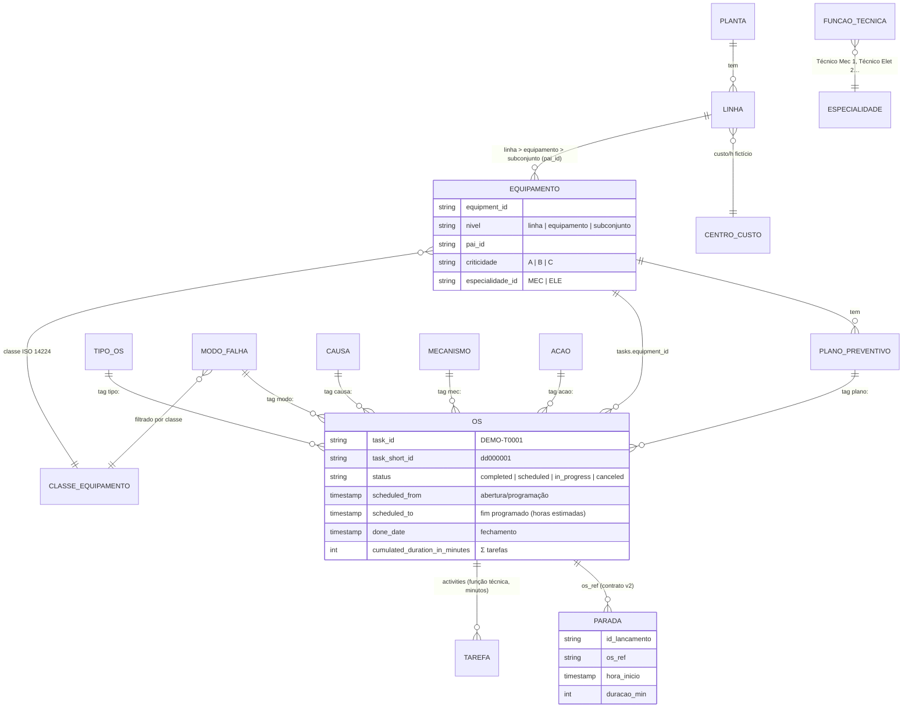

# Modelo de dados (dataset demo)

- **Fonte**: o conector simulado usa o **mesmo schema** do Data Connector do pipeline principal (`contrato/conector_v0.json`): tasks, activities, equipments, tasks_tags, tags.
- A classificação (tipo, modo, causa, mecanismo, ação, plano) vai em **tags** `chave:valor`, como num CMMS real.
- **Gold** (`sql/demo/`): `dim_linha`, `dim_equipamento`, `fato_os_demo`, `falhas`, `kpi_equipamento`, `kpi_linha`, `kpi_mensal`, `kpi_pm`, `pm_ocorrencias`, `backlog_os`, `backlog_especialidade`, `aderencia_semanal`, `pareto_modo`, `alertas_reincidencia`, `qualidade_dado`.
